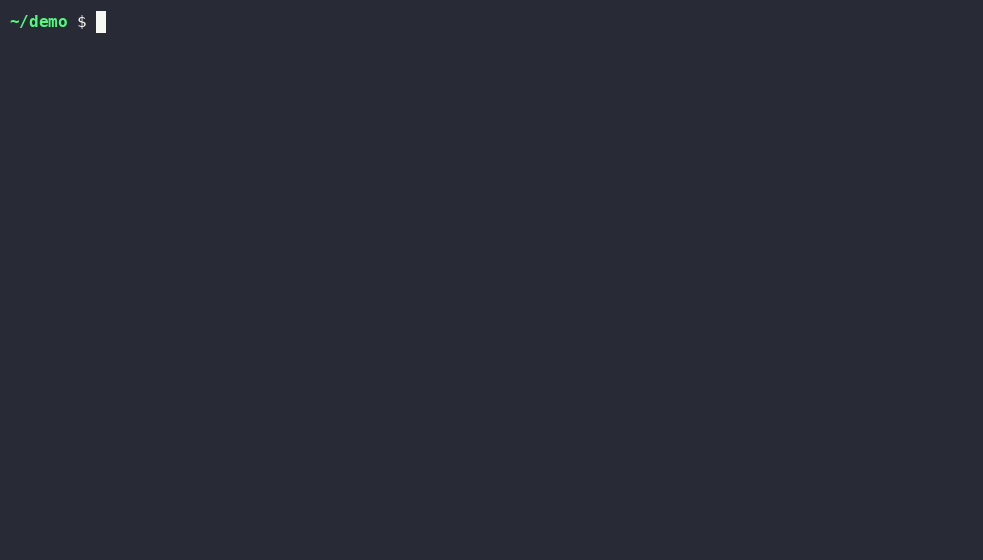
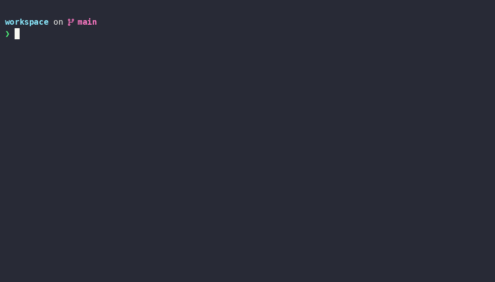
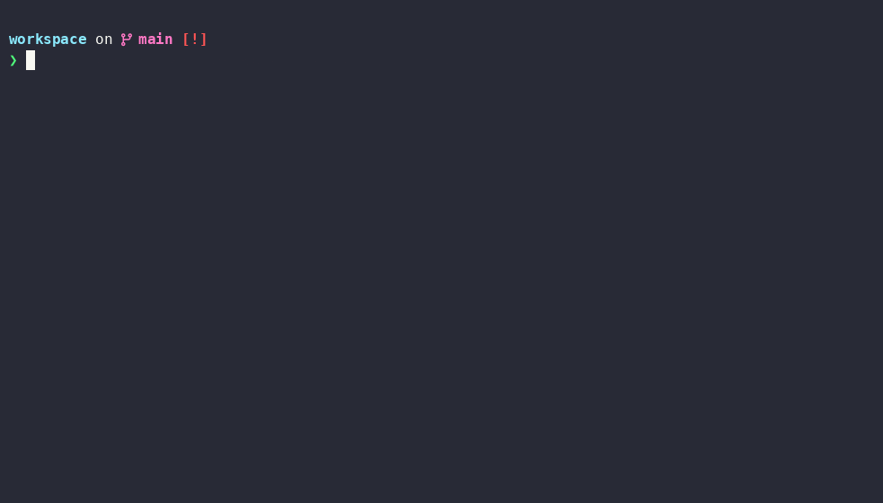

# isolate

Run a git project in a disposable microVM. Let an AI agent (or you) work on it
there. Get the result back as git refs, and review them before anything
touches your working tree.

```
your repo ──copy──▶ microVM (/workspace) ──git bundle at shutdown──▶ refs/remotes/isolate/*
                                                                      │
                                                           [d]iff [m]erge [s]quash [q]uit
```

The host shares nothing with the guest: no bind mounts, no 9p/virtiofs,
no ssh-agent, no credentials. The guest gets a copy of the repo, a per-project
cache disk, and filtered internet access. The only thing that comes back is a
git bundle. The launcher fetches it with object checks into a separate ref
namespace.

Coding agents: read [AGENTS.md](AGENTS.md) first.

## Why

Coding agents run commands with your full user privileges. The risk can be a
prompt-injected README, a malicious dependency, or only an overeager `rm -rf`.
Each one can read `~/.ssh`, your cloud credentials, other projects, or
anything on your LAN.
With isolate, the agent gets a whole machine where none of that exists. Its output
comes back the same way as a pull request from a stranger. It comes back as
commits that you read before you merge them.

[docs/motivation.md](docs/motivation.md) tells how each design choice answers
a survey of sandboxes for AI agents.

## See it work

Run one command in your repo. isolate copies the repo into a new microVM and
boots it.



Inside, the agent has a full Linux system. But it cannot see your home
directory, your keys or your local network.



The agent works on its copy of the repo. Here it also adds a line to a CI
workflow, a file that can run code outside the VM. Commits and changed files
go back to the host. Files that git ignores stay in the VM.


`isolate-done` stops the VM and sends the work back as git refs. isolate
flags the files that can run code and shows the diff. It merges nothing until
you tell it to.



## Quick start

### Requirements

- An x86-64 Linux host with KVM (`/dev/kvm`) and `sudo`.
- A Debian-family layout for the kernel: `/boot/vmlinuz-<version>` and the
  matching `linux-headers-<version>` package. The guest boots the host kernel.
  We test on Ubuntu.
- [mise](https://mise.jdx.dev). It installs Firecracker and podman from this
  repo's `mise/config.toml`.
- These distro packages: `fish`, `git`, `rsync`, `jq`, `e2fsprogs`
  (`mkfs.ext4`, `debugfs`), `iproute2`, `nftables` and `uidmap` (for rootless
  podman). For QEMU, also `qemu-system-x86`.
- AppArmor (recommended). It confines the VMM.
- An SSH public key at `~/.ssh/id_ed25519.pub`, or set `ISOLATE_SSH_PUBKEY`.

On Debian or Ubuntu:

```sh
sudo apt install fish git rsync jq e2fsprogs iproute2 nftables uidmap \
  linux-headers-$(uname -r) qemu-system-x86
```

### Changes to the host

isolate does not change your system configuration silently. With networking
on, the first launch does these steps with `sudo`:

- It copies `/boot/vmlinuz-<version>` to `~/.local/share/isolate/`, because
  only root can read it.
- It creates the `isolate0` TAP device, owned by your user.
- It sets `net.ipv4.ip_forward=1` for the whole host. This setting does not
  persist after a reboot.
- It loads the nftables table `inet isolate`, which does NAT for the guest.
  The table blocks the host, your LAN and private address ranges.
- If Docker is installed, it adds two `ACCEPT` rules for `isolate0` to the
  iptables `DOCKER-USER` chain. Docker would drop the guest traffic without
  them.
- If ufw is active, it adds two `ufw route allow` rules for `isolate0`.
  **These rules persist.** To remove them, use `sudo ufw status numbered` and
  `sudo ufw delete <number>`.

The launcher keeps the results. It does these steps again only when the
kernel or the ruleset changes. `ISOLATE_NET=none` skips all the network
steps. The build and the launcher write all other files to
`~/.local/share/isolate/`.

### Install

```sh
git clone https://github.com/soulstrop/isolate.git ~/projects/isolate
cd ~/projects/isolate
mise trust && mise install       # firecracker, podman, etc.
mise run isolate.build           # build the guest image (a few minutes the first time)

# once: confine the VMM with AppArmor (recommended)
sudo install -m644 apparmor/isolate-vm /etc/apparmor.d/
sudo apparmor_parser -r /etc/apparmor.d/isolate-vm
```

Then, from inside any git repository:

```sh
mise run isolate.fc              # Firecracker
mise run isolate.qemu            # or QEMU microvm
```

The tasks are in this repo's `mise/config.toml`, so `mise run` finds them only
from inside this directory tree. To use them from any project, add them to
your global `~/.config/mise/config.toml` with absolute paths. There,
`{{config_root}}` is `$HOME`, not this repo:

```toml
[tasks."isolate.fc"]
run = "fish $HOME/projects/isolate/mise/scripts/isolate-vm.fish fc"

[tasks."isolate.qemu"]
run = "fish $HOME/projects/isolate/mise/scripts/isolate-vm.fish qemu"

[tasks."isolate.build"]
run = "fish $HOME/projects/isolate/mise/scripts/isolate-build.fish"
```

Point at the scripts in place. Do not copy them: they find `image/`
and `apparmor/` relative to their own location. The launcher uses the
directory where you ran `mise run` as the project.

The first launch asks for sudo (see [Changes to the host](#changes-to-the-host)).

You land in a fish shell in `/workspace` as `agent-user`. Run `claude`,
`codex`, `pi`, `opencode`, `agy`, etc., or work by hand. When you finish:

```sh
isolate-done
```

The guest commits all uncommitted work to an `isolate-wip` branch, writes a
bundle, and powers off. Back on the host, you see the new commits, all
review warnings, and a prompt:

```
[d]iff  [m]erge  [s]quash (stage changes, no commit)  [q]uit:
```

`q` leaves everything in `refs/remotes/isolate/*` for later
(`git diff HEAD...isolate/isolate-wip`, `git merge isolate/isolate-wip`).

## Common use cases

**Let an agent work on a repo without supervision.** Launch, run `claude` (or
another agent), and walk away. Claude comes preconfigured:

- no setup wizard,
- the permission mode of your host,
- an auto-mode description of the VM (so local changes are routine, but data
  that goes out is not),
- the lumen, context-mode and pyright-lsp plugins.

See [docs/architecture.md](docs/architecture.md#claude-code-settings). The
worst it can do locally is to wreck the VM's copy of the repo and its own cache
disk. `--dangerously-skip-permissions` removes even the check on network
sends.

Log in to each agent one time for each project. Claude, Codex, pi, opencode
and Antigravity (`agy`) keep their logins, sessions and history on the
persistent cache disk of the project. The fish and bash histories are there
too. After each session, the launcher also copies the transcripts and shell
history to `~/.local/share/isolate/projects/<project>/logs/` on the host. So
you can see what the agent did, also after the VM is gone (see
[docs/architecture.md](docs/architecture.md#agent-state-and-session-logs)).

**Review agent work like a PR.** The branches of each session arrive under
`refs/remotes/isolate/`. The importer flags changes that can execute on your
machine (CI workflows, `mise.toml`, `package.json`, `Makefile`, git hooks
config, etc.). It also flags lines that contain bidirectional or zero-width
Unicode. Use `[d]iff` before `[m]erge`. Or use `[s]quash` to stage everything
as one uncommitted change that you can edit.

**Work from your editor.** With networking on, `ssh isolate` connects to the
guest. This needs the `Host isolate` block in `~/.ssh/config` (see
[docs/architecture.md](docs/architecture.md#ssh-and-editors)). In Emacs, open
`/ssh:isolate:/workspace/`. For root, open `/ssh:isolate|sudo:isolate:/etc/`.
VS Code Remote-SSH works the same way.

**Fully offline.** `ISOLATE_NET=none mise run isolate.fc` boots with no network
device at all, and needs no sudo. Use it to review untrusted code, or to run
a test suite that must not connect to the internet. Agents that need an API do
not work.

**Talk to a service on the host or LAN.** By default, the guest gets to the
public internet only. The firewall blocks your LAN, the host, and private
address ranges. Open specific TCP ports:

```sh
ISOLATE_ALLOW="host:5432 192.168.1.20:6379" mise run isolate.fc
```

`host` means the host's address on the VM link, `172.16.0.1`. So the service
must listen there (or on `0.0.0.0`), not on `127.0.0.1`. To make the list
permanent for a project, put the same list in
`~/.local/share/isolate/projects/<project>/allow`. For example, the lumen
plugin needs `host:11434`, and an Ollama on the host that listens on
`172.16.0.1` (see [docs/architecture.md](docs/architecture.md#plugins)).

**Recover a session that did not export.** The VM can stop without
`isolate-done` (crash, `kill`, power-off). Then the launcher keeps the project
disk as `project-unimported-<timestamp>.ext4` in the state dir of the project.
The launcher does not discard anything silently. Before it replaces unmerged
refs from previous sessions, it archives them to
`refs/isolate-archive/<timestamp>/`.

## Firecracker or QEMU?

Both boot the same image, disks, kernel and network, so a project works the
same under each. The difference is in the virtual machine monitor.

| | Firecracker (`isolate.fc`) | QEMU microvm (`isolate.qemu`) |
|---|---|---|
| Device model | Minimal: virtio block/net, serial. Nothing else exists. | microvm machine type, but one flag adds the full QEMU device catalogue |
| Attack surface | Small, Rust, purpose-built for untrusted multi-tenant code | Larger C codebase. The same AppArmor profile confines it. |
| Boot time | Fastest | Slightly slower |
| Kernel | Needs an uncompressed `vmlinux` (extracted one time with `extract-vmlinux` from your `linux-headers`) | Boots the stock `/boot/vmlinuz` |
| Where it comes from | mise pins it in this repo | Your distro's `qemu-system-x86` package |
| Extending | No GPUs, no USB, no extra device types | You can add devices (more disks, virtio-rng, GPU passthrough, other architectures through TCG) in the launcher |

**Use Firecracker by default**, especially for:

- agents that run without supervision with permissions skipped,
- third-party or unfamiliar code (dependency audits, a bug report that you
  reproduce from an untrusted repo),
- ordinary web, CLI, library and backend projects: anything that needs only a
  Linux userland, a compiler and the network.

**Use QEMU when the project needs something that Firecracker does not have**:

- hardware or device access (GPU/CUDA, USB, custom virtio devices). For this,
  you must change the QEMU arguments of the launcher.
- a different CPU architecture or emulated hardware (embedded, cross-arch
  testing),
- kernel or driver work where you want the QEMU debug tools (gdbstub,
  monitor),
- your host cannot use the mise-installed Firecracker, or you prefer the
  QEMU that your distro patches and updates.

If you are not sure, start with Firecracker. A change to the other costs
nothing, because the two share the per-project cache disk.

## Configuration at a glance

| Variable | Default | Effect |
|---|---|---|
| `ISOLATE_MEM` | `4096` | Guest RAM in MiB |
| `ISOLATE_CPUS` | `2` | vCPUs |
| `ISOLATE_NET` | (on) | `none` = no network, no sudo |
| `ISOLATE_ALLOW` | (empty) | Extra TCP destinations, `host:PORT` or `IP:PORT` |
| `ISOLATE_CACHE_SIZE` | `32G` | Size of a new per-project cache disk (sparse) |
| `ISOLATE_SSH_PUBKEY` | `~/.ssh/id_ed25519.pub` | Key authorized in the guest (build time) |
| `ISOLATE_DOTFILES` | (unset: none copied) | Stow-style dotfiles dir to copy into the image (build time, see [Dotfiles](docs/architecture.md#dotfiles)) |
| `ISOLATE_DOTFILE_PKGS` | `fish starship tmux claude` | Which packages from it (build time) |
| `ISOLATE_DOTFILE_EXCLUDE` | (empty) | Extra rsync exclude patterns for dotfiles, such as files that hold API keys (build time) |
| `ISOLATE_REFRESH` | (unset) | `1` = resolve `latest` tool versions again now (build time) |

[docs/architecture.md](docs/architecture.md) tells how to add or remove tools,
and describes the disk and filesystem layout, networking and the security
model. When something goes wrong, start with
[docs/troubleshooting.md](docs/troubleshooting.md).

## Repository layout

```
.github/ISSUE_TEMPLATE/      bug report and feature request forms
.github/workflows/check.yml  CI: runs isolate.check on each push and pull request
AGENTS.md                    rules and preferences for coding agents (CLAUDE.md imports it)
CONTRIBUTING.md              how to report a bug and send a change
LICENSE                      MIT
SECURITY.md                  how to report a vulnerability, and the threat model
apparmor/isolate-vm          AppArmor profile the VMM runs under
docs/motivation.md           why: the sandbox survey that isolate answers
docs/architecture.md         how it works: disks, boot, import, network, image
docs/troubleshooting.md      symptoms, causes, and how to narrow problems down
docs/development.md          build, test and debug changes to isolate itself
docs/roadmap/roadmap.md      current state, open questions, backlog
image/Containerfile          guest image recipe
image/mise/config.toml       guest-wide tools (agents, tmux, starship, ...)
image/claude/settings.json   guest Claude settings (auto-mode description of the VM)
image/claude/plugins         Claude plugins installed into the image
image/home/config.fish       guest ~/.config/fish/config.fish
image/rootfs/                files copied verbatim into the guest's /
mise/config.toml             this repo's tools and the isolate.* tasks
mise/scripts/isolate-build.fish   builds the image into rootfs.ext4
mise/scripts/isolate-vm.fish      launches a VM and imports the result
mise/scripts/isolate-check.fish   static checks (mise run isolate.check)
mise/scripts/isolate-test.fish    end-to-end smoke test (mise run isolate.test)
mise/scripts/isolate-drive.py     drives a launch through a pty for the test
mise/scripts/isolate-demo.fish    records the README demo (mise run isolate.demo)
mise/scripts/isolate-demo.py      types the demo steps for asciinema
```

## Testing changes to isolate

From this repo:

```sh
mise run isolate.check                    # lint scripts, configs, AppArmor profile, docs (STE); no VM
mise run isolate.test                     # check, then boot a throwaway repo under Firecracker
mise run isolate.test -- qemu --claude    # QEMU, and also start and quit Claude Code
```

[docs/development.md](docs/development.md) tells what each check and test
does, and how to drive and debug other launches. Read
[CONTRIBUTING.md](CONTRIBUTING.md) before you send a change.

## License

MIT. See [LICENSE](LICENSE).
